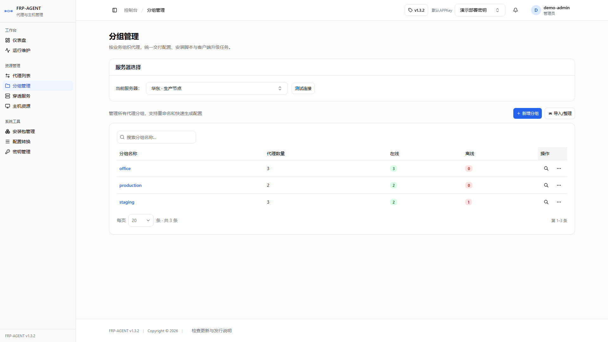
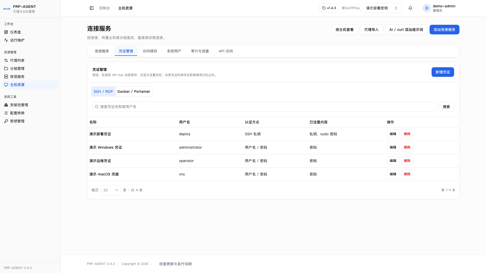
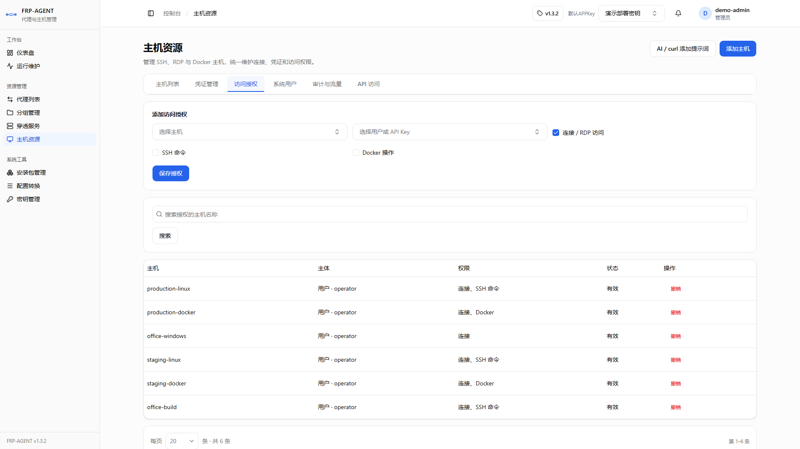
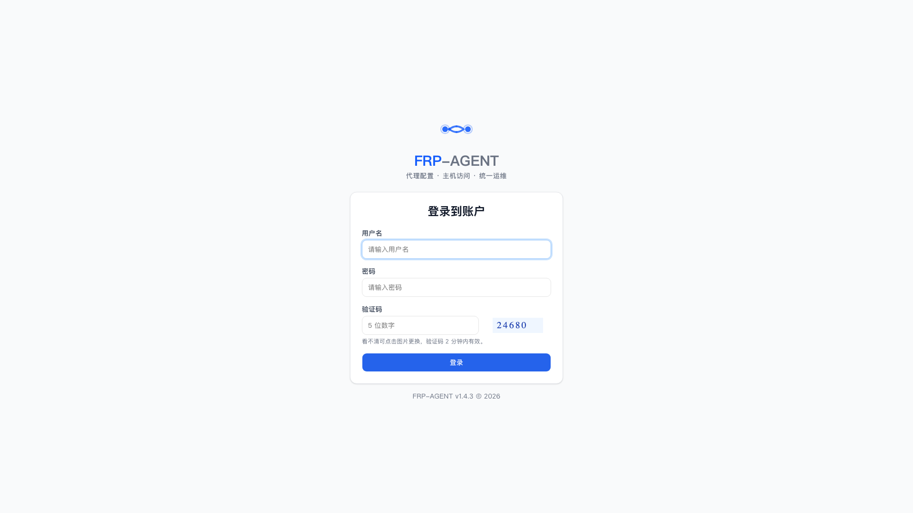

# FRP-AGENT

**FRP 代理配置、客户端交付与主机访问的一体化管理平台。**

FRP-AGENT 将多台 frps、代理分组、安装包和 SSH / Docker / RDP 主机资源放进同一个 Web 控制台。既可以完成内网穿透配置的日常维护，也可以按用户或 API Key 分配主机访问权限、执行远程操作并查看审计记录。

当前版本：**v1.3.3** · [发行说明](release-notes/1.3.3.md) · [Gitee 仓库](https://gitee.com/numen06/frp-agent) · [MIT License](LICENSE)


> 本文截图均为当前前端实际渲染的 **1920 × 1080** 截图，使用独立演示数据；域名、账号、凭据和运行状态不代表真实环境。[截图复现说明](docs/screenshots/README.md)

## 能做什么

| 场景 | 提供的能力 |
| --- | --- |
| 管理多个 FRP 节点 | 接入 frps、测试连接、查询版本，查看各节点代理数量与在线率 |
| 维护代理和端口 | 筛选、搜索、批量分组、端口识别与分配，比较 frps 状态和本地记录 |
| 按业务交付客户端 | 分组生成 INI / TOML 配置、Linux / Windows 安装脚本与 systemd 服务文件 |
| 管理客户端版本 | 同步或上传多平台 frpc 安装包，通过 SSH 扫描客户端版本并发起升级 |
| 统一访问主机 | 托管 SSH、Portainer Docker 和 RDP 资源，使用平台身份访问获授权主机 |
| 管理团队权限 | 系统用户、API Key、按主机授权，以及连接和远程操作审计 |
| 在手机上运维 | 左侧菜单与手机端抽屉导航、卡片列表、44px 触控区域、全屏弹窗与独立滚动表单 |

主机新增、编辑、克隆使用独立页面，支持未保存离页提醒；全站标题、卡片、表单、Tab 和操作反馈采用公共组件。后续前端改动遵循 [界面规范](frontend/AGENTS.md)。

## 代理与配置管理

### 可选内置 FRP 服务端

- 镜像构建时从 [FRP 官方 Releases](https://github.com/fatedier/frp/releases/tag/v0.71.1) 下载固定版本 **frps 0.71.1**，验证 SHA-256 后内置；容器启动时无需再次下载。
- 默认关闭。管理员首次登录本实例时提示一次“前往配置 / 暂不启用”，选择持久保存在数据库，以后在左侧 **穿透服务 → 内置服务** Tab 自行切换。
- 页面分为 **基础配置 / 安全设置 / 插件 / 原始配置文件**：可配置监听地址、控制端口、允许的代理端口池、HTTP/HTTPS、KCP/QUIC、日志级别，以及 TLS 证书、客户端 CA、额外 Token 校验和每客户端端口数。
- 无需编辑原始文件即可使用默认安全配置：自动生成独立的随机连接 Token 与内部管理密码，Token 可在网页查看、复制和修改；默认强制客户端 TLS，关闭调试分析和客户端详细错误，管理 API 仅监听回环地址并要求认证。默认不启用插件、KCP、QUIC 或 HTTP/HTTPS 入口。
- **插件**支持 frps 的 `httpPlugins` 回调，选择 Login、NewProxy 等事件；插件服务单独运行，HTTPS 插件默认校验证书。基础表单保存会保留原始配置中的插件、高级参数及不连续端口池。
- **原始配置文件**复用网页代码编辑器，仅管理员可读写，包含明文连接凭据。支持仅校验、保存应用和放弃草稿；原始保存与重启保留文件文本及注释，表单变更可能整理 TOML 格式。为兼容平台自动交付及监控，保留 Token 认证、明确的 `allowPorts` 和 `127.0.0.1` 内部管理认证；旧草稿与新配置冲突时拒绝覆盖。
- 迁移旧 frps 时，原始配置允许保留非空的旧 Token 和管理密码，避免要求现有客户端同时改配置；基础表单新设 Token 仍至少 16 字符，默认随机凭据与 TLS 设置保持不变。迁移后可再统一轮换旧凭据。
- 应用启用配置或保存原始文件前执行官方 `frps verify`；非法配置不会替换运行文件，启动失败时恢复原配置，运行中退出会自动尝试重启。修改启用配置会短暂中断现有连接。
- 启用后自动创建内置服务器记录，复用分组、配置生成、客户端交付和流量统计；该记录通过内置 FRP 面板维护。关闭时停止进程并保留配置，重启容器会恢复已保存的启用状态。
- 默认 Compose 映射控制端口 **7000/TCP**、代理池 **6000–6099/TCP 与 UDP**。更改端口或启用 HTTP/HTTPS 时，需要同步修改 Compose 的 `ports` 并重新创建容器、开放防火墙；页面不能动态修改 Docker 端口映射。内部管理 API 只监听 `127.0.0.1:7500`，无需对外暴露。
- 配置保存在 `/app/data`，复用已有凭据加密机制；部署时固定 `SSH_CREDENTIAL_SECRET`。本地运行可用 `BUILTIN_FRPS_BINARY` 指定 frps 可执行文件，用 `BUILTIN_FRPS_DIR` 指定生成配置目录。
- 从源码构建：`docker compose -f docker-compose.yml -f docker-compose.build.yml up -d --build`。调整 FRP 版本时，构建参数 `FRP_VERSION` 与对应平台的 `FRP_SHA256` 必须一起更新。

### 流量统计

- **代理列表 / 分组代理** 显示 frps 提供的当日入站、出站字节、连接数和采集时间。数据随定时或手动同步更新，是采集时的快照；按 frps 的自然日计数，服务重启可能清零。
- **主机资源 → 流量统计 / 审计与流量** 显示 SSH（含 SFTP）、RDP 网关、页面 SSH 命令及 Docker 操作的发送/接收字节，可按主机、操作者、来源 IP、动作和时间筛选。发送/接收按平台到主机方向；SSH/RDP 不含加密开销，Docker 统计请求和响应正文，不统计远端容器自身的网络用量。
- 主机连接在结束后入账，累计来自当前筛选条件下所有保留审计记录，清理日志会减少累计。旧记录或未支持的探测操作显示“未采集”，不会冒充零流量。普通用户与 API Key 仅能查看自己的记录；管理员可查看全部。
- FRP 代理与主机访问分别计数，同一传输可能经过两者，不能相加作为整机带宽。

### 运行维护（管理员）

仪表板保留代理汇总与服务器概览。管理员通过独立的“运行维护”入口查看“资源监控”“连接检查”“RDP 防护”三个 Tab；连接变化归入连接检查，资源趋势归入资源监控。

- 运行概览展示本实例 CPU、内存、系统可见内存、数据盘空间及应用运行时长。Linux 容器使用 cgroup v1/v2 计数，包含内置 frps 与 RDP 子进程；CPU 按容器可用核数归一化，内存扣除可回收文件缓存。非容器按应用主进程统计，无法读取的指标显示“未采集”。系统可见资源与容器限额分别展示，数据盘是数据目录所在文件系统。
- 资源每分钟采样，保留 7 天；近 24 小时趋势显示每 30 分钟峰值。采样保存在现有数据库，重启后保留，RDP 累计计数随应用重启重新开始。页面每 30 秒读取快照，隐藏页面暂停刷新；采集过期或读取失败会明确提示。
- FRP 状态默认每 60 秒同步，兼容已有 `SYNC_INTERVAL_SECONDS` 环境变量；旧部署若显式设为 3600，需要同步调整部署配置。支持 TCP、UDP、HTTP、HTTPS、STCP、SUDP、XTCP、TCPMUX；接口失败时保留上次代理状态并提示采集失败，旧版不支持的附加类型不会被误标离线。上下线历史按采集发现时间记录，不能代表准确断线时刻。
- 每 5 分钟对已注册的 TCP SSH 代理检查握手，最多 4 路并发，每路约 3 秒超时。仅检查配置本地端口为 22 或名称以 `ssh`（可跟数字）结尾的代理，不发送凭据；握手正常不代表登录成功，其他协议暂不主动探测。
- RDP 同一来源 5 分钟内累计 10 次客户端握手或认证失败，临时限制新连接 30 分钟，已授权连接不受影响。网关自身的上游连接错误不计入客户端封禁；重复错误每分钟汇总，原生日志错误行与连接失败分别计数。

### 多服务器与代理状态

- 接入多台 frps，集中维护服务地址、Dashboard API 认证和 FRP 连接参数。
- 定时同步代理状态，也可手动同步、刷新统计或测试服务器连接。
- 仪表板汇总在线 / 离线代理、唯一远端端口数量，并按服务器查看在线率。
- 代理支持新增、编辑、删除，按服务器、分组、状态或关键词筛选。
- 支持批量分组、端口自动识别、重复代理清理、状态历史及数据差异分析。
- 根据 ssh、rdp、http、mysql、redis 等常见服务名称识别本地端口，减少重复录入。


### 分组与客户端交付

- 从代理名称解析分组，或手动创建、重命名、调整代理归属。
- 新增分组默认生成 SSH / HTTP / Docker 标准代理，并直接打开配置生成；也可选择创建空分组。
- 删除包含代理的分组时，先显示代理与端口数量，再输入分组名确认；确认后删除该组配置并释放端口。
- 按分组或选中的代理生成 **INI / TOML** 配置；支持导入已有配置。
- 生成 Linux Bash / Windows PowerShell 安装与升级命令，配合 API Key 拉取安装包和配置。
- Linux 部署支持 systemd 服务文件；交付前可检查配置、依赖和端口分配情况。
- 通过 SSH 凭据扫描客户端版本、判断是否可升级，并查看升级任务结果。
- 提供 **INI → TOML** 转换工具，支持上传、粘贴、预览和下载。



[Linux 分组部署说明](docs/group-deploy-linux.md)

### 安装包中心

- 从 `fatedier/frp` 的 GitHub Releases 同步指定版本和平台，查看后台下载进度。
- 支持原始下载源及配置的加速源，也可手动上传安装包。
- 按版本、平台、来源筛选，查看文件大小、下载时间和 SHA-256 校验值。
- 为不同平台生成安装 / 升级脚本，并编辑脚本模板。


## 主机资源与远程访问

三种主机资源独立配置，共用平台身份、资源授权和访问审计。

| 资源 | Web 控制台 | 原生客户端入口 |
| --- | --- | --- |
| SSH | 连接测试、密码 / 私钥凭据、交互式 Web SSH、远程命令 API | SSH 跳板端口 `2222`，或浏览器内直接连接 |
| Docker / Portainer | 环境连接测试、查看容器、启动 / 停止 / 重启容器 | Docker Engine API 兼容 HTTPS 网关 `23750`，支持授权认证与客户端证书 |
| RDP | 托管 Windows 密码凭据、获取目标证书指纹、下载 `.rdp` 连接文件 | RDP/TLS 单端口网关 `13389`，平台账号代登录 Windows |

- 主机可新增、编辑、克隆、打标签，按实际权限显示操作入口。
- SSH 首次连接记录主机指纹，后续连接校验；RDP 新增时可自动读取并保存目标证书 SHA-256 指纹。
- 主机卡片点击 **Web SSH** 可进入交互式终端，需要主机执行权限、有效凭据与已记录的指纹。支持 Ctrl+C、Tab、窗口缩放及断开重连；离开页面会断开会话并提示确认。授权撤销最多 15 秒内生效，每用户最多 4 路、服务最多 16 路，空闲 15 分钟或运行 1 小时后结束会话。
- Web SSH 使用同源 WebSocket `/api/managed-hosts/{id}/terminal`，反向代理需转发 `Upgrade` / `Connection`。认证放在第一条 WebSocket 消息中，不放入 URL；生产环境通过 HTTPS/WSS 访问；审计只记录会话与流量，不录制终端输入输出。无法重启已有网关的部署可用同镜像单独运行 `uvicorn app.webssh:app`，共享受保护的配置及数据目录，并仅在内部网络开放该进程。
- RDP 平台账号入口支持 NLA/CredSSP；客户端使用“平台账号#主机名”和平台密码。首次使用或修改密码后，先登录一次网页。
- RDP 的 `.rdp` 文件不包含 Windows 密码；API Key 使用 TLS 连接文件，不能作为 Windows App 的 NLA 账号登录。
- 凭据加密保存在服务端；获授权用户无需拿到目标主机的真实密码或私钥。
- 管理员在“主机资源 → 凭证管理”集中维护 SSH / RDP 与 Docker / Portainer 凭证，支持分页搜索、新增、编辑、替换敏感内容与删除；编辑时留空保留原值，正在使用的凭证禁止删除。




### 授权与审计

管理员可将主机授权给系统用户或 API Key，分别控制连接、SSH 命令、Docker 操作。普通用户仅能看到获授权的主机，管理员可管理用户启停和 SSH 公钥。

审计记录操作者、主机、动作、结果、来源地址和时间。RDP 区分网关授权、实际桌面连接和断开，便于确认访问是否真正完成。

访问审计支持每页 20 条、按主机 / 动作 / 结果 / 时间筛选，以及查看命令输出详情。管理员可以删除选中的记录，或先预览再按保留天数清理；普通用户仅能查看自己的记录。




完整接入步骤、原生客户端命令和网关配置见 [主机资源管理说明](docs/host-management.md)。

## 登录与手机端体验



- 网页登录使用一次性图片验证码，**2 分钟有效**，点击图片可以更换。
- 验证码或密码错误后，后端按 **2 / 4 / 8 … 300 秒**执行退避，页面显示等待倒计时；刷新页面不能解除后端限制。
- Basic Auth 和旧配置令牌的密码认证入口共用退避；同一来源连续切换用户名尝试也有限制。API Key 认证继续用于自动化接入。
- 默认账号首次登录会提示修改密码；支持系统用户和 API Key 管理。
- 手机端使用左侧菜单与手机端抽屉导航；列表以卡片显示，筛选和分页适配窄屏。
- 数据列表和远程选择器默认 **20 条 / 页**，可切换 10 / 20 / 50 / 100 条；跨页选择服务器、分组、凭据、安装包或密钥时保留已选项。
- 弹窗统一为全屏操作面板，标题 / 关闭入口固定，内容独立滚动，操作栏适配安全区与软键盘可视高度。
- 字体与头像无需访问外部服务，适合内网部署。

[分页覆盖范围与 API 接入说明](docs/pagination.md)

## macOS VNC 远程桌面

主机管理支持 VNC / macOS，通过已核验指纹的 Mac SSH 通道连接屏幕共享，使用平台连接授权、服务端密码代用及会话审计，无需公网开放 5900。浏览器入口强制 HTTPS/WSS，配置与限制见 [macOS VNC 接入说明](docs/vnc-macos.md)。

## 快速部署

### 直接使用项目镜像（推荐）

项目镜像采用固定版本标签，例如 `registry.cn-shanghai.aliyuncs.com/numen/frp-agent:1.3.3`（需对应镜像已发布）。dev 分支测试可通过 `FRP_AGENT_IMAGE` 指定已构建的开发镜像；源码构建使用 `docker-compose.build.yml`。常规部署直接拉取镜像，无需在本地安装 Node.js、Python 或编译依赖。

以下为 Linux / macOS Shell 示例。首次部署创建独立目录并保存凭据加密密钥：

```bash
mkdir -p frp-agent/data
cd frp-agent
# 已有部署请保留原 .env 和 SSH_CREDENTIAL_SECRET，不要重新生成。
printf 'SSH_CREDENTIAL_SECRET=%s\n' "$(openssl rand -hex 32)" > .env
docker pull registry.cn-shanghai.aliyuncs.com/numen/frp-agent:1.3.3
docker run -d \
  --name frp-agent \
  --restart unless-stopped \
  --env-file .env \
  -p 8000:8000 \
  -p 2222:2222 \
  -p 23750:23750 \
  -p 13389:13389 \
  -p 7000:7000 \
  -p 6000-6099:6000-6099/tcp \
  -p 6000-6099:6000-6099/udp \
  -v "$(pwd)/data:/app/data" \
  registry.cn-shanghai.aliyuncs.com/numen/frp-agent:1.3.3
```

启动后访问 `http://localhost:8000`。默认用户名 / 密码为 `admin` / `admin`，首次登录后修改密码。也可在 `.env` 中设置 `AUTH_USERNAME`、`AUTH_PASSWORD`，用于初始化默认用户。

### Docker Compose：使用项目镜像

仓库默认 Compose 同样直接使用项目镜像，适合集中维护配置和后续升级：

```bash
git clone --branch dev --depth 1 https://gitee.com/numen06/frp-agent.git
cd frp-agent
mkdir -p data
# 首次部署生成凭据加密密钥；已有部署请保留原值，不要重新生成。
printf 'SSH_CREDENTIAL_SECRET=%s\n' "$(openssl rand -hex 32)" > .env
docker compose pull
docker compose up -d --no-build
```

镜像版本以已发布的镜像标签及启动后的页面版本为准；Git 标签与镜像发布分别进行，不代表仓库中已有同名镜像。需要固定版本时，将 `image` 改为镜像仓库中已发布的版本标签或摘要。

### 自行编译（可选）

需要修改源码或构建尚未发布镜像的提交时，在仓库根目录执行：

```bash
docker compose -f docker-compose.yml -f docker-compose.build.yml up -d --build
```

该配置构建本地 `frp-agent:local` 镜像，端口、环境变量及数据挂载沿用默认 Compose。后续自行编译升级继续使用这条命令。

### 按需开放服务

| 端口 | 用途 | 默认状态 |
| --- | --- | --- |
| `8000` | Web 控制台与 HTTP API | 启用 |
| `2222` | 原生 SSH 跳板 | 启用 |
| `23750` | Docker HTTPS 网关 | 启用 |
| `13389` | RDP/TLS 网关 | **关闭**，完成公网地址和证书配置后启用 |

Compose 已声明这四个端口映射。RDP 需要在 `data` 中放置配置指定的 TLS 证书与私钥，并设置 `RDP_GATEWAY_ENABLED=true`、`RDP_GATEWAY_PUBLIC_ADDRESS`。Docker 网关的证书域名应与客户端访问地址一致。

### 主要配置

| 环境变量 | 源码默认值 | 作用 |
| --- | --- | --- |
| `APP_HOST` / `APP_PORT` | `0.0.0.0` / `8000` | Web 监听地址和端口 |
| `AUTH_USERNAME` / `AUTH_PASSWORD` | `admin` / `admin` | 初始化用户；已有数据库用户优先 |
| `DATABASE_URL` | `sqlite:///./data/frp_agent.db` | 数据库连接 |
| `SYNC_INTERVAL_SECONDS` | `60` | 代理状态同步周期（秒）；已有部署的显式环境变量优先 |
| `PACKAGES_DIR` | `data/packages` | 安装包目录 |
| `SSH_CREDENTIAL_SECRET` | 空 | SSH、Docker、RDP 凭据加密密钥，正式部署须设置并保持不变 |
| `SSH_GATEWAY_ENABLED` / `SSH_GATEWAY_PORT` | `true` / `2222` | SSH 网关 |
| `DOCKER_GATEWAY_ENABLED` / `DOCKER_GATEWAY_PORT` | `true` / `23750` | Docker HTTPS 网关 |
| `DOCKER_GATEWAY_TLS_COMMON_NAME` | `localhost` | Docker 网关证书访问域名或 IP |
| `RDP_GATEWAY_ENABLED` / `RDP_GATEWAY_PORT` | `false` / `13389` | RDP 网关 |
| `RDP_GATEWAY_PUBLIC_ADDRESS` | 空 | 客户端使用的 RDP 公网地址，含端口 |
| `RDP_GATEWAY_TLS_CERT_PATH` / `RDP_GATEWAY_TLS_KEY_PATH` | `data/rdp_gateway_cert.pem` / `data/rdp_gateway_key.pem` | RDP TLS 证书及私钥 |
| `RDP_GATEWAY_TRUSTED_PROXIES` | 空 | RDP 相关 HTTP 请求信任的反代 CIDR |

应用及网关按**单进程**运行。验证码与登录退避状态保存在进程内，15 分钟无活动后清理，重启后重置；不要使用多 worker 部署来分摊认证请求。登录限流使用 ASGI 提供的客户端地址，部署反代时只信任实际代理来源。

### 升级

如果旧版 `docker-compose.yml` 只有 `build` 配置，先将 `frp-agent` 服务的 `build` 配置块替换为 `image: registry.cn-shanghai.aliyuncs.com/numen/frp-agent:1.3.3`，保留现有环境变量、端口和数据挂载，再按以下步骤升级。

1. 备份 `data` 目录、部署配置和现有加密密钥。
2. 使用项目镜像的 Compose 部署执行 `docker compose pull`，再执行 `docker compose up -d --no-build`。使用 `docker run` 部署时，先拉取镜像，再停止并删除原容器，使用原 `.env`、数据目录及端口参数重新创建容器。
3. 检查页面版本、主机资源和已启用网关。升级 RDP 后先用平台密码登录网页，再连接远程桌面。

应用的“检查更新”读取 **Gitee Release**，单独推送 Git tag 不会自动产生 Release。版本变化和升级细节见 [发行说明目录](release-notes/README.md)。

## 本地开发

```bash
python -m venv .venv
# 激活虚拟环境后：
pip install -r backend/requirements.txt
cd frontend
npm ci
npm run build
cd ..
python backend/app.py
```

前端开发可在 `frontend` 运行 `npm run dev`，默认将 API 请求代理到 `127.0.0.1:8000`。后端测试使用 `python -m pytest backend/tests -q`。

技术栈：Vue 3、Vite、Pinia、Tailwind CSS 4、shadcn-vue（Reka UI）、CodeMirror；FastAPI、SQLAlchemy、SQLite、APScheduler、Paramiko；RDP 网关使用 FreeRDP。Dockerfile 包含前端和 RDP 插件构建流程。
