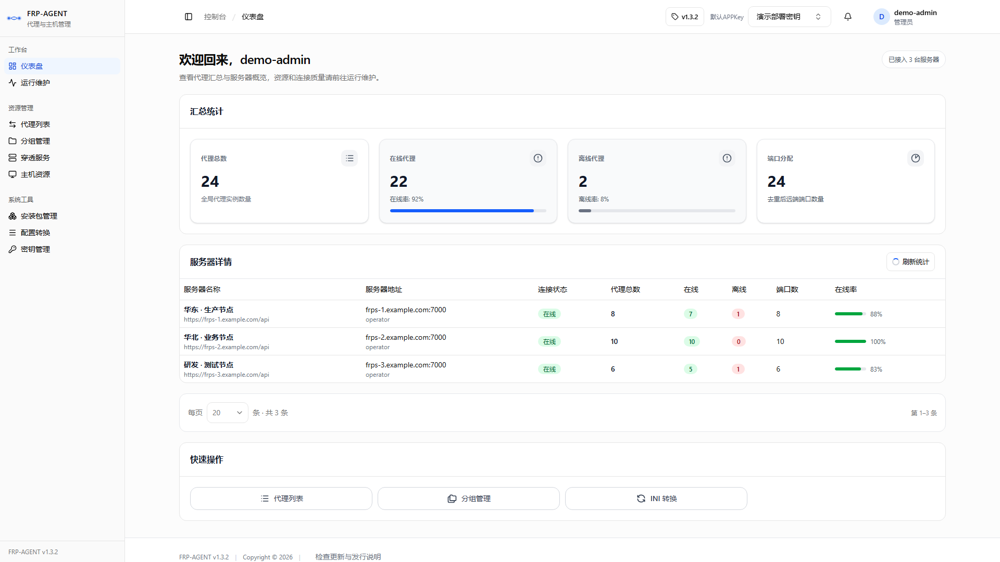
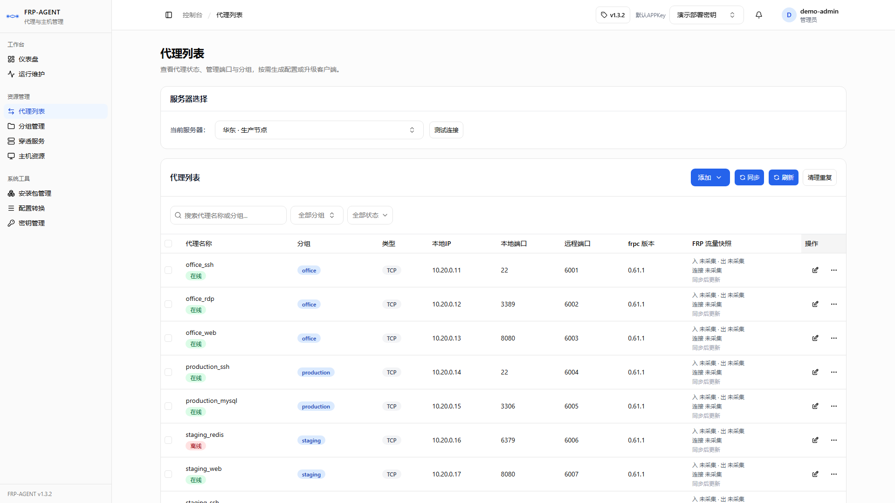
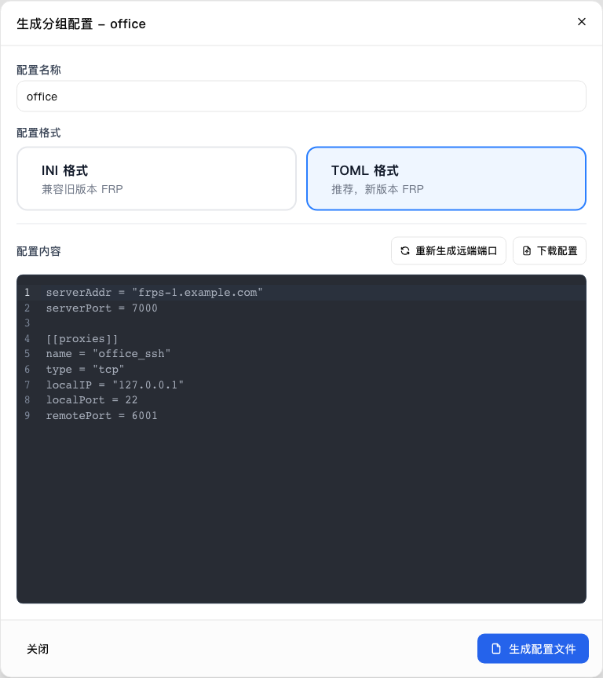
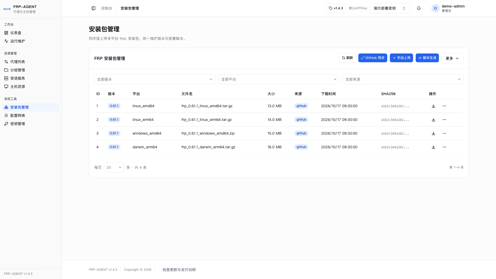
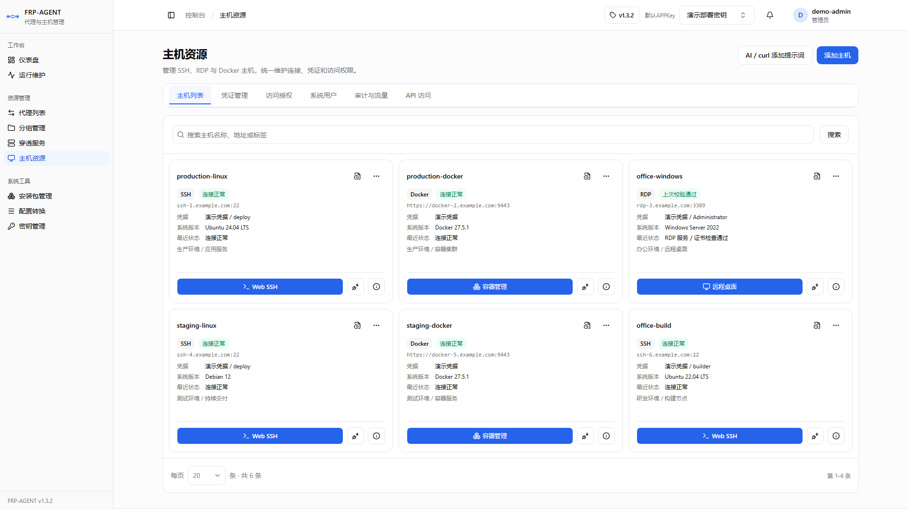
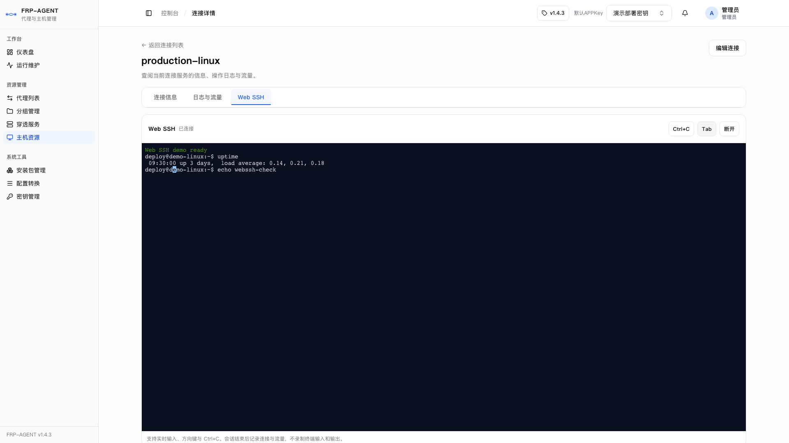
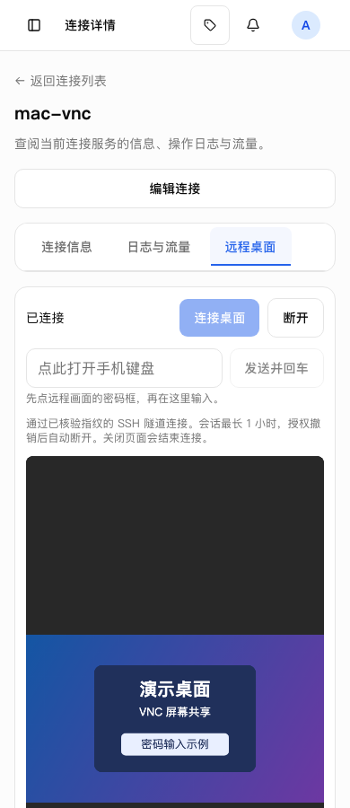
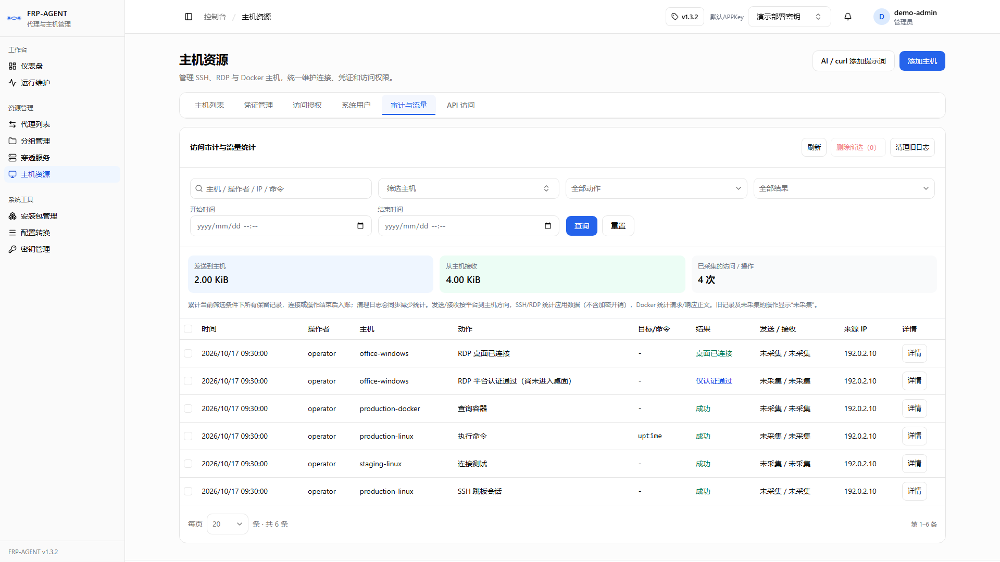

# FRP-AGENT

用一个 Web 控制台管理多台 frps、代理分组和客户端配置，也可以远程访问 SSH、Docker / Portainer、Windows RDP 和 macOS VNC。

**当前版本 1.4.3** · [发行说明](release-notes/1.4.3.md) · [完整截图](docs/screenshots/README.md) · [MIT 许可证](LICENSE)



## 快速部署

安装 Docker 和 Docker Compose 后，用 Bash 执行以下命令完成首次部署：

```bash
git clone --depth 1 --branch v1.4.3 https://gitee.com/numen06/frp-agent.git
cd frp-agent
(umask 077; set -C; printf 'AUTH_PASSWORD=%s\nSSH_CREDENTIAL_SECRET=%s\n' \
  "$(openssl rand -hex 16)" "$(openssl rand -hex 32)" > .env)
docker compose pull
docker compose up -d --no-build
```

打开 [http://localhost:8000](http://localhost:8000)，以 `admin` 和 `.env` 中的 `AUTH_PASSWORD` 登录。默认镜像是 `registry.cn-shanghai.aliyuncs.com/numen/frp-agent:1.4.3`，也提供 `latest`。通过公网使用控制台时请配置 HTTPS，网页远程桌面需要同源 HTTPS/WSS。

## 管理 FRP 代理

1. 打开 **穿透服务**，添加已有 frps 并测试管理接口，或在 **内置服务** 中启用本机 frps。
2. 在 **代理列表** 同步代理，按节点、分组和状态查询。到 **分组管理** 生成或导入 INI / TOML，并按组生成客户端安装脚本。
3. 在 **安装包管理** 同步或上传 frpc 安装包。代理异常时，到 **运行维护** 查看资源和连接检查。[运行维护截图](docs/screenshots/operations.png)







内置 frps 默认使用 `7000/TCP`，Compose 已映射 `6000–6099/TCP、UDP` 作为默认代理端口池。修改端口后同步调整 Compose 和防火墙。[Linux 分组部署](docs/group-deploy-linux.md)

## 连接主机

打开 **主机资源 → 添加连接服务**，选协议并填写地址、端口和凭据。可选已有主机，留空则保存时创建同名主机。列表可按连接、主机、分组和协议查询。

| 协议 | 从哪里连接 | 操作截图 |
| --- | --- | --- |
| SSH | **Web SSH** 打开交互式终端。也可通过原生 SSH 网关访问。 | [Web SSH 终端](docs/screenshots/webssh.png) |
| Docker / Portainer | **容器管理** 查看、启动、停止或重启容器。 | [容器列表](docs/screenshots/host-docker.png) |
| RDP | 校验目标证书后下载 `.rdp`，用 Windows 远程桌面客户端打开。 | [RDP 连接和证书](docs/screenshots/host-rdp.png) |
| macOS VNC | 先在 Mac 开启屏幕共享和 VNC 密码控制。添加 VNC 连接后，点 **远程桌面 → 连接桌面**。 | [添加 VNC](docs/screenshots/vnc-add.png) |





VNC 直连填写可从平台访问的内网地址和实际端口，SSH 隧道可选。手机遇到锁屏时，先点远程画面的密码框，再点网页里的 **点此打开手机键盘**，输入后选 **发送并回车**。[macOS VNC 接入](docs/vnc-macos.md)



团队使用时，在 **主机资源 → 访问授权** 给用户或 API Key 分配所需连接，在 **审计与流量** 查看访问记录。[访问授权截图](docs/screenshots/host-access.png) · [凭据、权限和原生客户端接入](docs/host-management.md)



## 升级已有部署

先备份数据目录和部署配置，保留原来的 `SSH_CREDENTIAL_SECRET`。在原部署的 `.env` 中设置以下镜像，再拉取并重建容器：

```dotenv
FRP_AGENT_IMAGE=registry.cn-shanghai.aliyuncs.com/numen/frp-agent:1.4.3
```

```bash
docker compose pull
docker compose up -d --no-build
```

如果旧 Compose 固定了 `image:`，在原配置中更新镜像标签。升级后从页面或 `/api/public/version` 确认版本。

需要从源码构建时，在仓库根目录运行 `docker compose -f docker-compose.yml -f docker-compose.build.yml up -d --build`。
