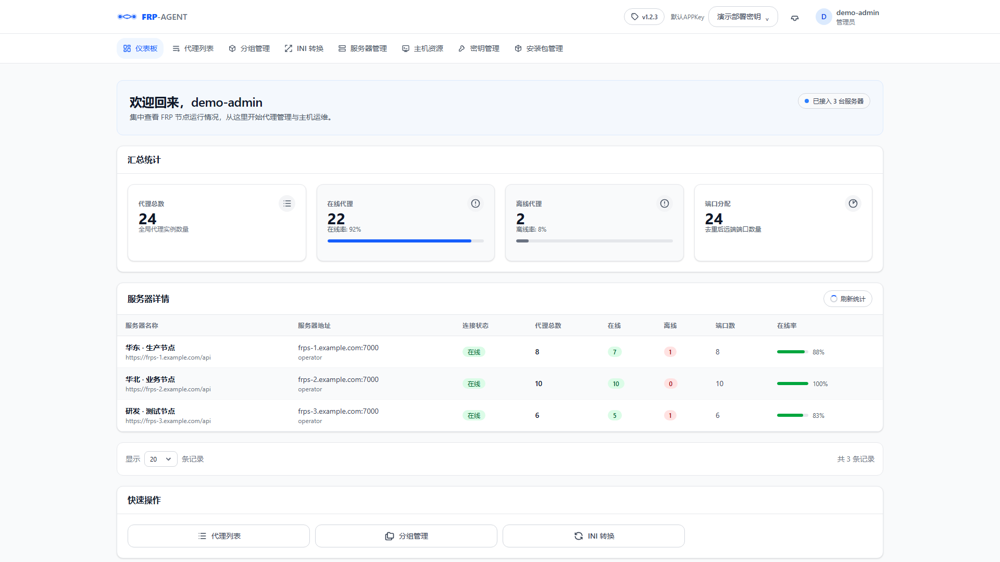
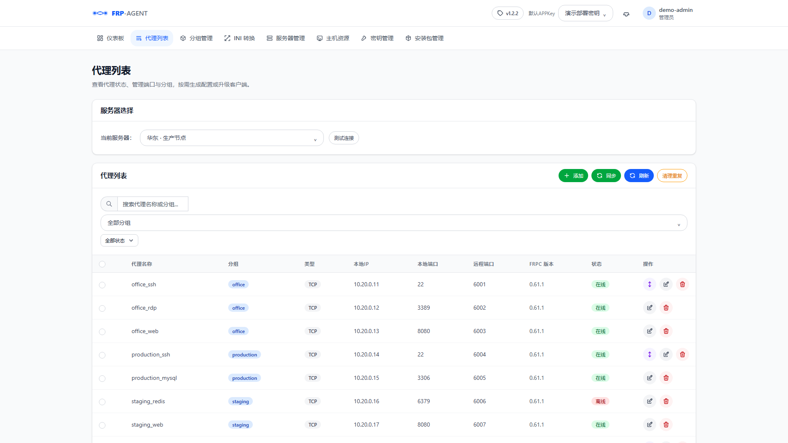
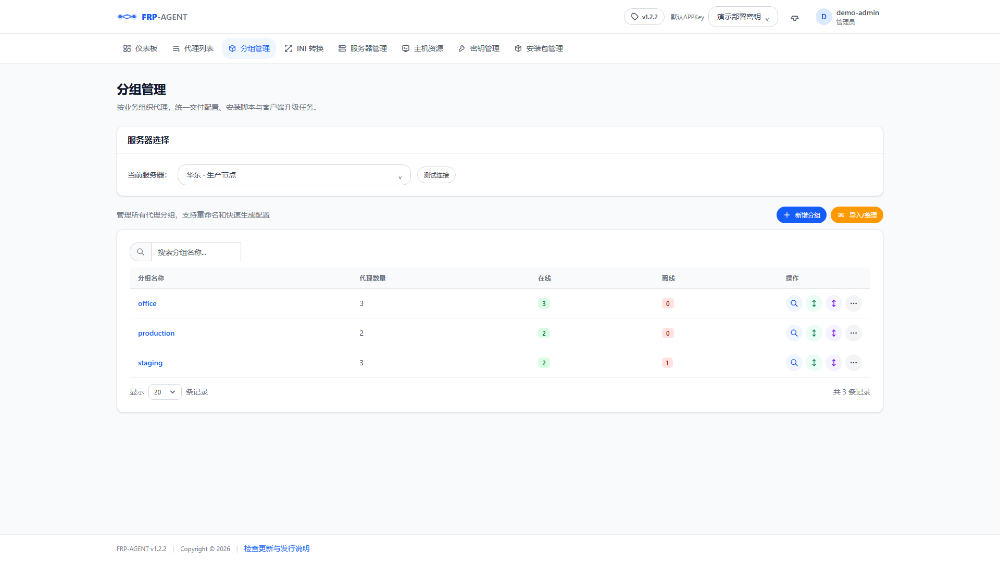
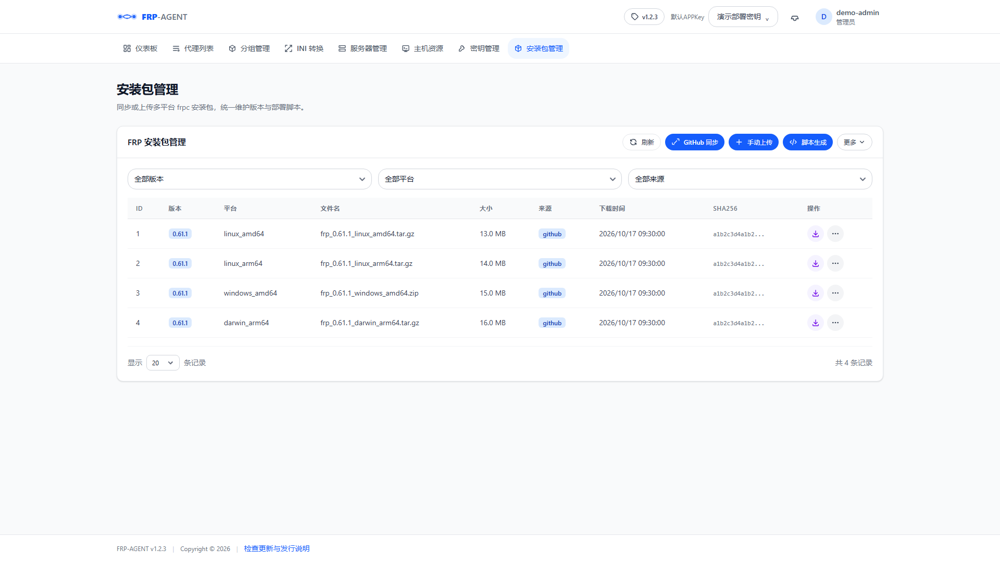
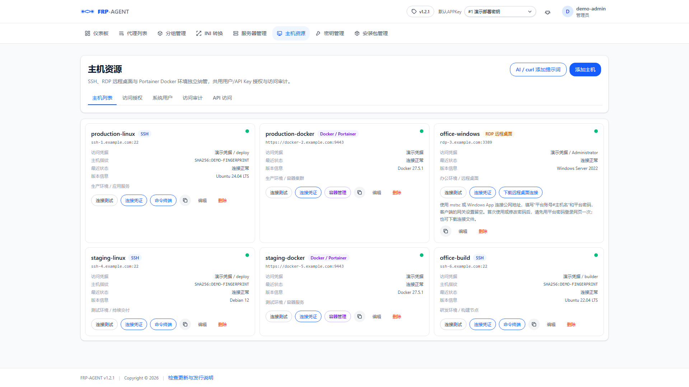
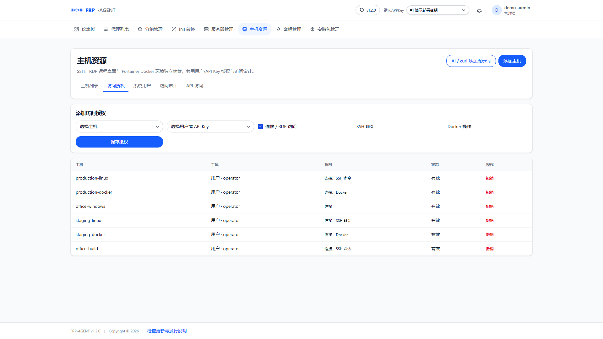
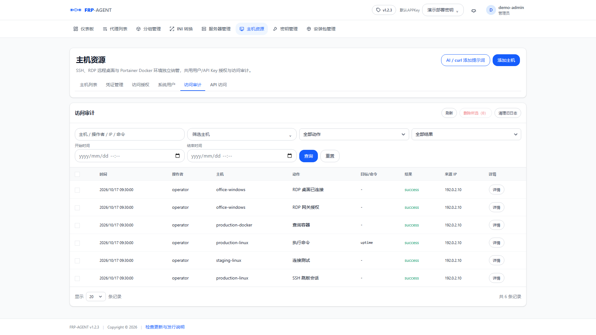
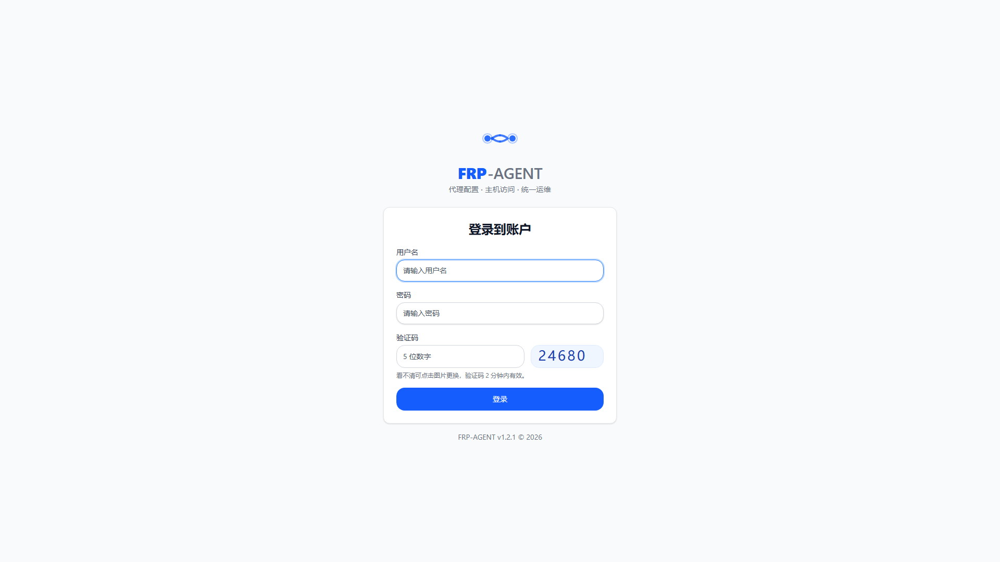

# FRP-AGENT

**FRP 代理配置、客户端交付与主机访问的一体化管理平台。**

FRP-AGENT 将多台 frps、代理分组、安装包和 SSH / Docker / RDP 主机资源放进同一个 Web 控制台。既可以完成内网穿透配置的日常维护，也可以按用户或 API Key 分配主机访问权限、执行远程操作并查看审计记录。

当前版本：**v1.2.1** · [发行说明](release-notes/1.2.1.md) · [Gitee 仓库](https://gitee.com/numen06/frp-agent) · [MIT License](LICENSE)



> 本文截图均为当前前端实际渲染的 **1920 × 1080** 截图，使用独立演示数据；域名、账号、凭据和运行状态不代表真实环境。[截图复现说明](docs/screenshots/README.md)

## 能做什么

| 场景 | 提供的能力 |
| --- | --- |
| 管理多个 FRP 节点 | 接入 frps、测试连接、查询版本，查看各节点代理数量与在线率 |
| 维护代理和端口 | 筛选、搜索、批量分组、端口识别与分配，比较 frps 状态和本地记录 |
| 按业务交付客户端 | 分组生成 INI / TOML 配置、Linux / Windows 安装脚本与 systemd 服务文件 |
| 管理客户端版本 | 同步或上传多平台 frpc 安装包，通过 SSH 扫描客户端版本并发起升级 |
| 统一访问主机 | 托管 SSH、Portainer Docker 和 RDP 资源，使用平台身份访问获授权主机 |
| 管理团队权限 | 系统用户、API Key、按主机授权，以及连接和远程操作审计 |
| 在手机上运维 | 底部快捷导航、卡片列表、44px 触控区域、全屏弹窗与独立滚动表单 |

## 代理与配置管理

### 多服务器与代理状态

- 接入多台 frps，集中维护服务地址、Dashboard API 认证和 FRP 连接参数。
- 定时同步代理状态，也可手动同步、刷新统计或测试服务器连接。
- 仪表板汇总在线 / 离线代理、唯一远端端口数量，并按服务器查看在线率。
- 代理支持新增、编辑、删除，按服务器、分组、状态或关键词筛选。
- 支持批量分组、端口自动识别、重复代理清理、状态历史及数据差异分析。
- 根据 ssh、rdp、http、mysql、redis 等常见服务名称识别本地端口，减少重复录入。



### 分组与客户端交付

- 从代理名称解析分组，或手动创建、重命名、调整代理归属。
- 按分组或选中的代理生成 **INI / TOML** 配置；支持导入已有配置。
- 生成 Linux Bash / Windows PowerShell 安装与升级命令，配合 API Key 拉取安装包和配置。
- Linux 部署支持 systemd 服务文件；交付前可检查配置、依赖和端口分配情况。
- 通过 SSH 凭据扫描客户端版本、判断是否可升级，并查看升级任务结果。
- 提供 **INI → TOML** 转换工具，支持上传、粘贴、预览和下载。



[Linux 分组部署说明](docs/group-deploy-linux.md)

### 安装包中心

- 从 `fatedier/frp` 的 GitHub Releases 同步指定版本和平台，查看后台下载进度。
- 支持原始下载源及配置的加速源，也可手动上传安装包。
- 按版本、平台、来源筛选，查看文件大小、下载时间和 SHA-256 校验值。
- 为不同平台生成安装 / 升级脚本，并编辑脚本模板。



## 主机资源与远程访问

三种主机资源独立配置，共用平台身份、资源授权和访问审计。

| 资源 | Web 控制台 | 原生客户端入口 |
| --- | --- | --- |
| SSH | 连接测试、密码 / 私钥凭据、远程命令、管理员 sudo 操作 | SSH 跳板端口 `2222`，使用平台用户或获授权 API Key |
| Docker / Portainer | 环境连接测试、查看容器、启动 / 停止 / 重启容器 | Docker Engine API 兼容 HTTPS 网关 `23750`，支持授权认证与客户端证书 |
| RDP | 托管 Windows 密码凭据、获取目标证书指纹、下载 `.rdp` 连接文件 | RDP/TLS 单端口网关 `13389`，平台账号代登录 Windows |

- 主机可新增、编辑、克隆、打标签，按实际权限显示操作入口。
- SSH 首次连接记录主机指纹，后续连接校验；RDP 新增时可自动读取并保存目标证书 SHA-256 指纹。
- RDP 平台账号入口支持 NLA/CredSSP；客户端使用“平台账号#主机名”和平台密码。首次使用或修改密码后，先登录一次网页。
- RDP 的 `.rdp` 文件不包含 Windows 密码；API Key 使用 TLS 连接文件，不能作为 Windows App 的 NLA 账号登录。
- 凭据加密保存在服务端；获授权用户无需拿到目标主机的真实密码或私钥。



### 授权与审计

管理员可将主机授权给系统用户或 API Key，分别控制连接、SSH 命令、Docker 操作。普通用户仅能看到获授权的主机，管理员可管理用户启停和 SSH 公钥。

审计记录操作者、主机、动作、结果、来源地址和时间。RDP 区分网关授权、实际桌面连接和断开，便于确认访问是否真正完成。





完整接入步骤、原生客户端命令和网关配置见 [主机资源管理说明](docs/host-management.md)。

## 登录与手机端体验



- 网页登录使用一次性图片验证码，**2 分钟有效**，点击图片可以更换。
- 验证码或密码错误后，后端按 **2 / 4 / 8 … 300 秒**执行退避，页面显示等待倒计时；刷新页面不能解除后端限制。
- Basic Auth 和旧配置令牌的密码认证入口共用退避；同一来源连续切换用户名尝试也有限制。API Key 认证继续用于自动化接入。
- 默认账号首次登录会提示修改密码；支持系统用户和 API Key 管理。
- 手机端使用底部快捷导航和“全部功能”面板；列表以卡片显示，筛选和分页适配窄屏。
- 弹窗统一为全屏操作面板，标题 / 关闭入口固定，内容独立滚动，操作栏适配安全区与软键盘可视高度。
- 字体与头像无需访问外部服务，适合内网部署。

## 快速部署

### Docker Compose：从版本标签构建

```bash
git clone --branch v1.2.1 https://gitee.com/numen06/frp-agent.git
cd frp-agent
mkdir -p data
# 首次部署生成凭据加密密钥；已有部署请保留原值，不要重新生成。
printf 'SSH_CREDENTIAL_SECRET=%s\n' "$(openssl rand -hex 32)" > .env
docker compose up -d --build
```

启动后访问 `http://localhost:8000`。默认用户名 / 密码为 `admin` / `admin`，首次登录后修改密码。也可在 `.env` 中设置 `AUTH_USERNAME`、`AUTH_PASSWORD`，用于初始化默认用户。

本步骤从标签构建镜像，不依赖镜像仓库是否已发布同名版本。

### 按需开放服务

| 端口 | 用途 | 默认状态 |
| --- | --- | --- |
| `8000` | Web 控制台与 HTTP API | 启用 |
| `2222` | 原生 SSH 跳板 | 启用 |
| `23750` | Docker HTTPS 网关 | 启用 |
| `13389` | RDP/TLS 网关 | **关闭**，完成公网地址和证书配置后启用 |

Compose 已声明这四个端口映射。RDP 需要在 `data` 中放置配置指定的 TLS 证书与私钥，并设置 `RDP_GATEWAY_ENABLED=true`、`RDP_GATEWAY_PUBLIC_ADDRESS`。Docker 网关的证书域名应与客户端访问地址一致。

### 主要配置

| 环境变量 | 源码默认值 | 作用 |
| --- | --- | --- |
| `APP_HOST` / `APP_PORT` | `0.0.0.0` / `8000` | Web 监听地址和端口 |
| `AUTH_USERNAME` / `AUTH_PASSWORD` | `admin` / `admin` | 初始化用户；已有数据库用户优先 |
| `DATABASE_URL` | `sqlite:///./data/frp_agent.db` | 数据库连接 |
| `SYNC_INTERVAL_SECONDS` | `1800` | 代理同步周期；仓库 Compose 设置为 `30` 秒 |
| `PACKAGES_DIR` | `data/packages` | 安装包目录 |
| `SSH_CREDENTIAL_SECRET` | 空 | SSH、Docker、RDP 凭据加密密钥，正式部署须设置并保持不变 |
| `SSH_GATEWAY_ENABLED` / `SSH_GATEWAY_PORT` | `true` / `2222` | SSH 网关 |
| `DOCKER_GATEWAY_ENABLED` / `DOCKER_GATEWAY_PORT` | `true` / `23750` | Docker HTTPS 网关 |
| `DOCKER_GATEWAY_TLS_COMMON_NAME` | `localhost` | Docker 网关证书访问域名或 IP |
| `RDP_GATEWAY_ENABLED` / `RDP_GATEWAY_PORT` | `false` / `13389` | RDP 网关 |
| `RDP_GATEWAY_PUBLIC_ADDRESS` | 空 | 客户端使用的 RDP 公网地址，含端口 |
| `RDP_GATEWAY_TLS_CERT_PATH` / `RDP_GATEWAY_TLS_KEY_PATH` | `data/rdp_gateway_cert.pem` / `data/rdp_gateway_key.pem` | RDP TLS 证书及私钥 |
| `RDP_GATEWAY_TRUSTED_PROXIES` | 空 | RDP 相关 HTTP 请求信任的反代 CIDR |

应用及网关按**单进程**运行。验证码与登录退避状态保存在进程内，15 分钟无活动后清理，重启后重置；不要使用多 worker 部署来分摊认证请求。登录限流使用 ASGI 提供的客户端地址，部署反代时只信任实际代理来源。

### 升级

1. 备份 `data` 目录、部署配置和现有加密密钥。
2. 更新源码到目标标签，重新构建并启动容器：`docker compose up -d --build`。
3. 检查页面版本、主机资源和已启用网关。升级 RDP 后先用平台密码登录网页，再连接远程桌面。

应用的“检查更新”读取 **Gitee Release**，单独推送 Git tag 不会自动产生 Release。版本变化和升级细节见 [发行说明目录](release-notes/README.md)。

## 本地开发

```bash
python -m venv .venv
# 激活虚拟环境后：
pip install -r backend/requirements.txt
cd frontend
npm ci
npm run build
cd ..
python backend/app.py
```

前端开发可在 `frontend` 运行 `npm run dev`，默认将 API 请求代理到 `127.0.0.1:8000`。后端测试使用 `python -m pytest backend/tests -q`。

技术栈：Vue 3、Vite、Pinia、Tailwind CSS 4、Flowbite、CodeMirror；FastAPI、SQLAlchemy、SQLite、APScheduler、Paramiko；RDP 网关使用 FreeRDP。Dockerfile 包含前端和 RDP 插件构建流程。
